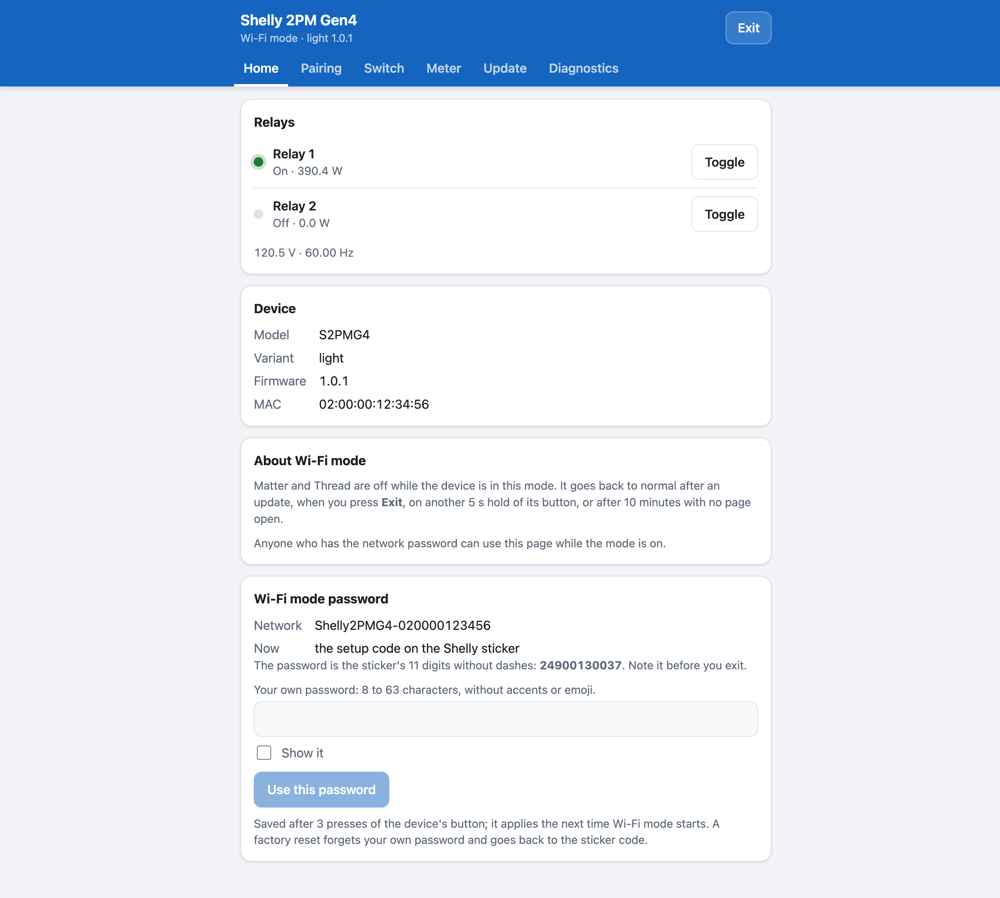
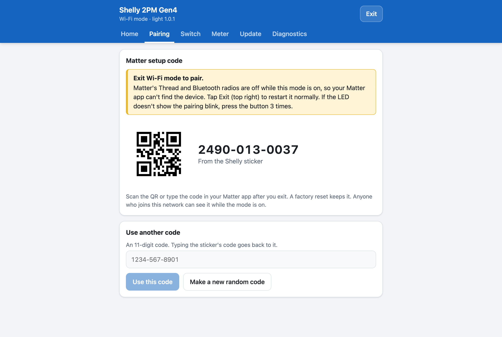
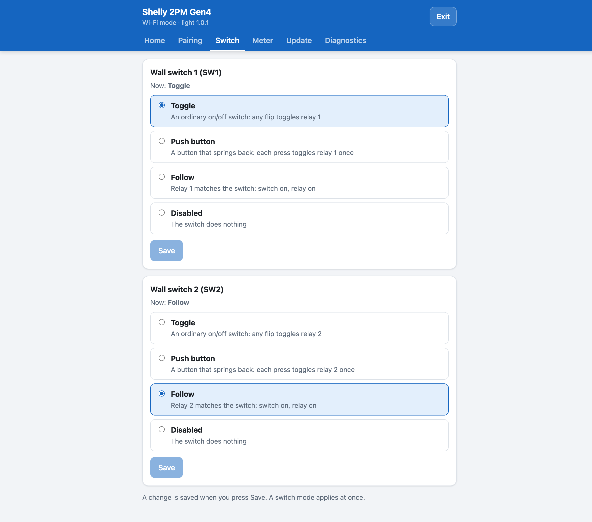
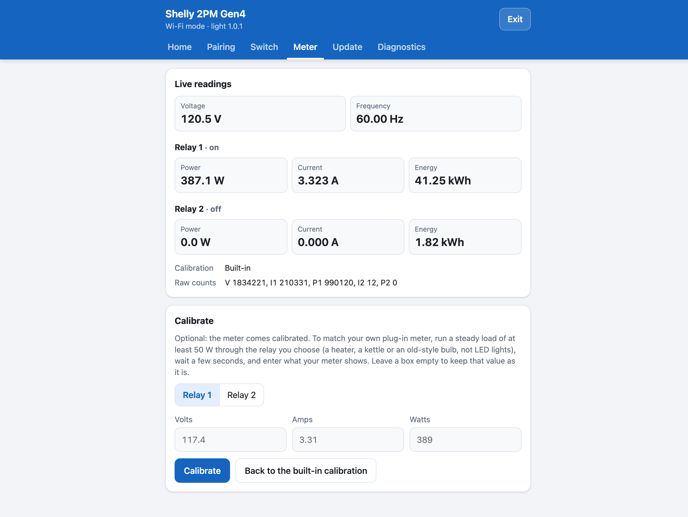
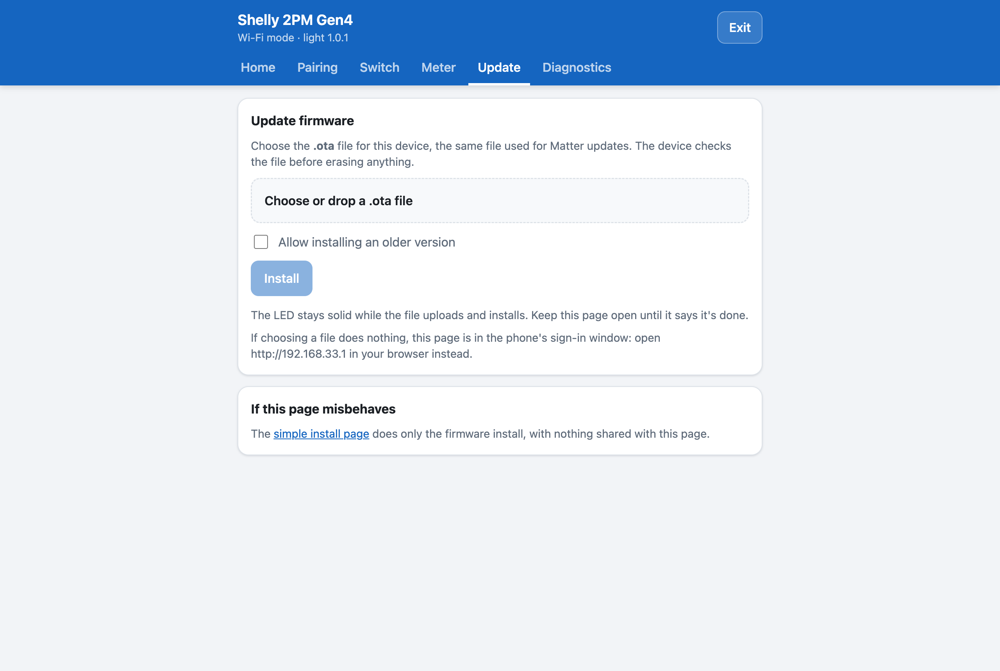
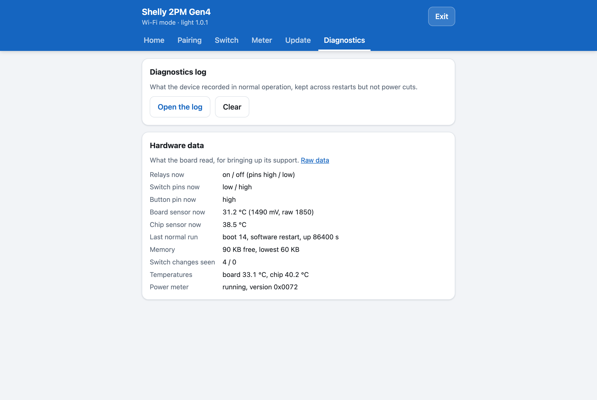
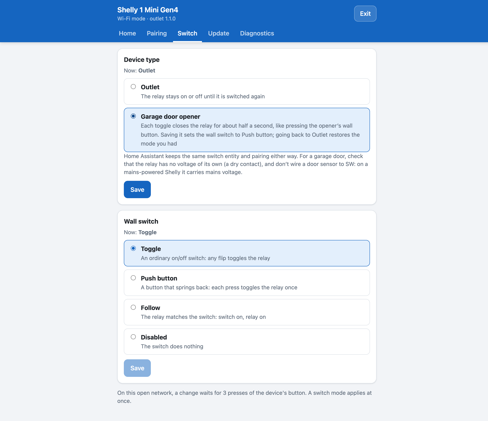

# Shelly Gen4 — Matter over Thread

 

Open source firmware that turns Shelly Gen4 relays into **Matter over Thread** devices. They work directly with Apple Home, Google Home, Alexa and Home Assistant, with no Shelly app, no cloud and no Wi-Fi in everyday use.

You install it from the Shelly's own web page, with no wires or soldering. After that the device has a built-in maintenance page you can open from your phone at any time. On it you can update the firmware, see the pairing code, set up the wall switch, calibrate the meter and check diagnostics.

> ⚠️ **Read this first.** Installing this firmware voids your Shelly warranty, and Shelly can't support a device running it. Installing from the web page is one-way: there is no going back to stock firmware unless you made a full backup over a USB-UART adapter first. The firmware uses Matter test credentials, so your app will warn that the device is uncertified. It is for personal use, not resale. This project isn't affiliated with Shelly, Allterco Robotics, the CSA or Espressif. See [Reversibility](docs/REVERSIBILITY.md) and [Certification](docs/CERTIFICATION.md).

---

## Contents

- [Credits](#credits)
- [How this differs from the original](#how-this-differs-from-the-original)
- [Features](#features)
- [Screenshots](#screenshots)
- [Supported devices](#supported-devices)
- [Get started](#get-started)
- [Documentation](#documentation)
- [License](#license)

---

## Credits

This project is built on the original [Shelly Gen4 Matter over Thread firmware by Automatous](https://github.com/automatous-io/shelly-1-gen4-matter-thread). Automatous did the hard groundwork on the hardware: working out Shelly's custom partition layout and the GPIO quirks of these boards, and getting Matter over Thread pairing to work on real Shelly hardware rather than a dev kit. That produced the first open source Matter over Thread firmware for the Shelly 1 Gen4. None of this would exist without it.

## How this differs from the original

The original firmware showed that Shelly Gen4 relays can run Matter over Thread. This fork builds on it to make the devices more complete and safer to live with day to day. The goal is to make it turnkey: flash it once, then set everything up from the device's own maintenance page, without building firmware yourself or reaching for developer tools.

- **More devices.** Adds the Shelly 1PM Gen4 (with a power meter) and the Shelly 2PM Gen4 (two relays, each with its own meter).
- **One firmware per device.** Instead of a separate build for each variant, you install one firmware and choose on the maintenance page whether the device is a Light, an Outlet, a Garage door opener or a Light Switch. The Shelly 1 Mini Gen4 gains a garage door opener, Light and Light Switch.
- **Update from your browser.** The original updates only over Matter through Home Assistant, after copying the file into its Matter Server's folder. Here you can also hold the button for 5 s, connect your computer or phone to the device's own Wi-Fi network and drop the update file onto its web page. It works with Apple Home, Google Home or Alexa, keeps your pairings, checks the file is for your device before erasing anything, and can go back to an older version.
- **A maintenance page on the device.** The same page shows the pairing code, changes settings and checks diagnostics, from any browser. Normally you never need Home Assistant or a USB adapter to recover or update a device.
- **More fail-safes.**
  - An update that crashes or hangs is rolled back automatically (with this firmware's bootloader, which the web install puts in place).
  - A watchdog restarts the device if Matter stops responding.
  - A device that fails to start 3 times in a row opens its maintenance page instead, so a bad setting or firmware can't leave it unreachable.
  - A separate recovery page can still install firmware if the main page has a bug.
  - A corrupted settings area is wiped and rebuilt instead of causing a boot loop.
  - Every release package is checked so it never turns on secure boot, flash encryption or eFuse writes, which could lock you out of the chip.
- **Electrical protection.** Over-temperature protection on every device. On the 1PM and 2PM, overcurrent and overvoltage protection, a stuck-relay alert and meter calibration. Faults are reported to Matter and shown on the LED.
- **Edge cases handled gracefully.**
  - The button follows stock Shelly's gestures and acts when you let go, so a long press never toggles the load by accident.
  - The original's factory reset fired after 1.5 s instead of 10 s; that's fixed.
  - A turn-on the device refuses shows on the LED instead of silently doing nothing.
  - Pins left latched by the stock firmware are released at boot.
  - Wall switch glitches are filtered out.
  - A garage door opener can't trigger by itself when the device powers up.
- **Pairs with the code on your sticker.** Your Shelly already has a Matter QR code and setup code on its sticker. After flashing, that's still the code you scan, just as with stock firmware. The original project paired every device with the same fixed test code instead.
- **Better security.** The maintenance network is protected with WPA2/WPA3. Its password is the setup code from your sticker, or one you choose, so only someone who has the device in hand can join. Changing that password also takes 3 presses of the device's button. A device without a sticker code runs an open network until you set your own password, and there every change waits for 3 presses.

## Features

**Pairing**
- Pairs with Apple Home, Google Home, Alexa and Home Assistant, and with several of them at once.
- Uses the setup code and QR code on the device's own Shelly sticker. You can also set your own code, or have the device make a random one.
- Press the button 3 times to open pairing again, for example to add a second ecosystem.

**Updates and reliability**
- Update from a browser on your computer or phone: hold the button 5 s, connect to the device's Wi-Fi network and drop the file onto its page. No Home Assistant, USB adapter or developer tools needed, and your pairings are kept.
- The page checks that the file is for your device before erasing anything, and can install an older version on request.
- Or update over Matter through Home Assistant, also keeping your pairings.
- A failed update rolls back by itself, once the device has this firmware's bootloader (installed from the web page or over USB-UART, not by a Matter update). During a Matter update the LED blinks evenly, 1 s on and 1 s off, so you know not to unplug it.
- A watchdog restarts the device if Matter stops responding, and if the device fails to start 3 times in a row it opens the maintenance page instead, so it can always be fixed over Wi-Fi.
- Settings that can't be read are wiped and rebuilt instead of causing a boot loop.

**Control**
- Stock Shelly button gestures: tap to toggle, press 3 times to pair, hold 5 s for Wi-Fi mode, hold 10 s to factory reset. The LED shows what letting go will do. See the [Button guide](docs/BUTTON-GUIDE.md).
- Wall switch modes: an ordinary toggle switch, a push button, follow the switch position, or disabled.
- Choose the power-on state: off, on, toggle or the last state (the Matter StartUpOnOff setting).
- The LED shows pairing, joining, connected, updating and faults, and Identify makes it blink so you can find the device.

**Maintenance page (Wi-Fi mode)**
- Its own Wi-Fi network named like stock Shelly's, protected by the sticker's setup code or a password you choose (open on a device without a sticker code, until you set one).
- Choose the device type (Light, Outlet, Garage door opener, Light Switch, as the device allows).
- Tabs for Home, Pairing, Switch, Meter, Update and Diagnostics, showing only the ones your device uses (Meter only on the 1PM and 2PM). It works on computers and phones, and follows light or dark mode.
- A separate recovery page at `/recovery` that can still install firmware if the main page fails.
- Changes save as soon as you press Save. Two exceptions wait for 3 presses of the device's button: the Wi-Fi mode password, so a typo can't lock you out, and every change while the network is open (a device without a sticker code, until you set your own password).

**Protection and metering**
- Over-temperature protection on every device, with a temperature sensor shown in your app.
- 1PM and 2PM: power, voltage, current and energy readings in Matter, plus overcurrent and overvoltage protection and meter calibration against your own plug-in meter.
- Faults are reported to Matter (General Diagnostics) and shown on the LED.

**Thread**
- Every device is a full Thread router, so it extends your Thread mesh for other devices.

## Screenshots

The maintenance page, shown with sample data.

| Home | Pairing |
|---|---|
|  |  |
| **Switch** | **Meter** |
|  |  |
| **Update** | **Diagnostics** |
|  |  |

   
  <em>On the Shelly 1 Mini Gen4, the Switch tab also chooses between Outlet and Garage door opener.</em>

## Supported devices

| Device | Device types (chosen on the maintenance page) | Status |
|---|---|---|
| Shelly 1 Gen4 | Light, Outlet, Garage door opener (with door sensor), Light Switch | Released as separate builds; the single firmware is new and not yet tested on hardware |
| Shelly 1 Mini Gen4 | Outlet, Garage door opener, Light, Light Switch | Outlet released; the other types are new and not yet tested on hardware |
| Shelly 1PM Gen4 | Outlet, Light, with a power meter | Ran and paired on one unit; metering and protection not yet tested on hardware |
| Shelly 2PM Gen4 | Outlet or Light, two relays with a meter each | The first build ran on one device; the metering build isn't tested on hardware yet. Not for motors or covers (see the [2PM checklist](docs/FLASHING.md#shelly-2pm-gen4-checklist)) |

Each device runs one firmware, and you pick what it is on its maintenance page. Changing to a type with other Matter endpoints means pairing the device again; the page warns you first.

**Which type do I pick?**
- **Light** or **Outlet:** both switch the load on and off the same way. They only differ in how your app shows the device, as a light or as an outlet. Pick the one that matches what you wired.
- **Garage door opener:** each command closes the relay for half a second, like pressing the opener's wall button.
- **Light Switch:** the wall switch controls other Matter devices through a binding instead of the device's own relay.

You also need a **Thread border router** for Matter over Thread: a HomePod mini or HomePod (2nd gen), an Apple TV 4K (2nd gen, or the 3rd gen Wi-Fi + Ethernet model), a Google Nest Hub (2nd gen) or Google TV Streamer, an Echo (4th gen) or a newer Echo with Thread, or Home Assistant with a Thread radio such as a Connect ZBT-1 or ZBT-2. See [Get started](docs/GETTING-STARTED.md#what-you-need).

## Get started

1. **Check what you need:** a supported device on stock firmware, a Thread border router, and a phone. Your stock firmware also has to be on the right app slot; the guide shows how to check.
2. **Install:** download your device's package from the [latest release](../../releases/latest) and upload it on the Shelly's own web page.
3. **Pair:** factory reset once, then scan the QR code on the Shelly sticker with your Matter app.

The full step-by-step guide, with answers to the common gotchas, is in **[Getting Started](docs/GETTING-STARTED.md)**.

## Documentation

- [Getting Started](docs/GETTING-STARTED.md): install, pair, and the FAQ
- [Button guide](docs/BUTTON-GUIDE.md): what every press and hold does, and what the LED means
- [Commissioning](docs/COMMISSIONING.md): pairing with each ecosystem in detail
- [Updating](docs/UPDATING.md): Matter updates and the maintenance page
- [Protection and Metering](docs/PROTECTION.md): what protects the device, and calibrating the meter
- [Flashing Guide](docs/FLASHING.md): the web install in detail, USB-UART flashing and backups
- [Reversibility](docs/REVERSIBILITY.md): warranty, factory keys, and going back to stock
- [Button, Switch and LED specification](docs/BUTTON-AND-LED.md): the exact behavior in every state, checked by the tests
- [Building from Source](docs/BUILDING.md), [Releasing](docs/RELEASING.md), [GPIO Map](docs/GPIO.md), [Power Consumption](docs/POWER.md), [Certification](docs/CERTIFICATION.md)
- [Stock Firmware Features](docs/STOCK-FEATURES.md), [Roadmap](docs/ROADMAP.md), [Changelog](CHANGELOG.md)
- [Contributing](docs/CONTRIBUTING.md), [Security policy](SECURITY.md)

## License

Apache 2.0. See [LICENSE](LICENSE) and [NOTICE](NOTICE).

This is a modified version of the [original project by Automatous](https://github.com/automatous-io/shelly-1-gen4-matter-thread). Both are based on Espressif's [ESP-Matter](https://github.com/espressif/esp-matter) examples, licensed under Apache 2.0.
