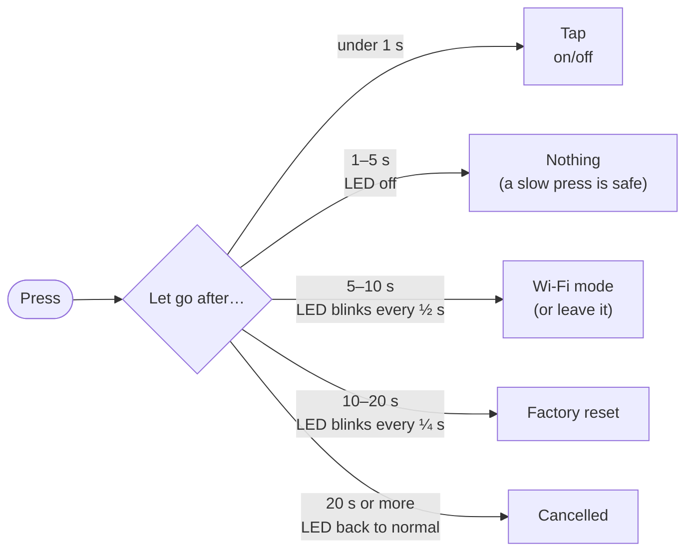
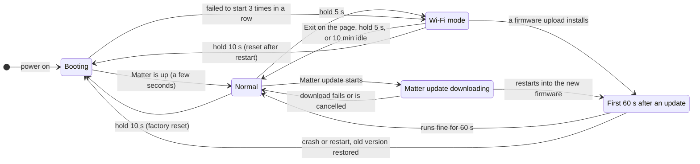

# Button guide

**[README](../README.md)** > **Button guide** · [Report an issue](../../../issues/new)

The button on the device, the wall switch wired to SW, and the status LED are the only controls on the device itself. This page explains them in plain terms. The exact behavior in every state, which the firmware's tests check, is in the [Button, Switch and LED specification](BUTTON-AND-LED.md).

> **Quick card**
> - **Tap:** on/off
> - **Press 3 times:** open pairing
> - **Hold 5 s:** Wi-Fi mode (the maintenance page)
> - **Hold 10 s:** factory reset
> - **Keep holding past 20 s:** cancel
> - **Shelly 2PM:** tap for relay 1, press twice for relay 2
>
> **Nothing happens while you hold.** The LED shows what letting go will do, and the action happens when you let go.

The gestures and timings match stock Shelly firmware. They apply to every device and device type here.

## Contents

- [Presses](#presses)
- [Holds](#holds)
- [What the device is doing](#what-the-device-is-doing)
- [When the button is refused](#when-the-button-is-refused)
- [The wall switch](#the-wall-switch)
- [What the LED means](#what-the-led-means)

---

## Presses

| You do | What happens |
|---|---|
| **Tap** (shorter than 1 s) | Turns the relay on or off. On a garage door opener, it gives a half-second pulse. |
| **2 quick taps** | **Shelly 2PM:** turns relay 2 on or off. Other devices: the same as one tap. |
| **3 or more quick taps** | Opens pairing, so you can add the device to an app. In Wi-Fi mode, saves a change the page is waiting for. |

Presses count together when they come less than 0.3 s apart. A tap acts about 0.3 s after you let go, once it's clear no more presses are coming. That short wait is what lets 3 presses open pairing without switching the load 3 times.

Each press gives a brief blink off on the LED, so you can count your presses.

## Holds

Hold the button and watch the LED. It changes as you pass each step, and whatever it shows when you let go is what happens.

| Hold for | LED while you hold | Let go and… |
|---|---|---|
| Under 1 s | Normal | It's a tap. |
| 1 to 5 s | Off | Nothing happens, so a slow press never switches or resets anything by accident. |
| 5 to 10 s | Blinks every ½ second | **Wi-Fi mode** starts: the device restarts with its own Wi-Fi network and the maintenance page. In Wi-Fi mode, the same hold leaves it. |
| 10 to 20 s | Blinks every ¼ second | **Factory reset:** the pairings and Thread network are cleared, and the device restarts ready to pair. |
| 20 s or more | Back to normal | Nothing: you changed your mind. |

**What a factory reset keeps and clears**
- **Clears:** every pairing, the Thread network, a setup code you entered on the page (it goes back to the sticker code, or to the device's own code if it has no sticker code), a Wi-Fi mode password you set (it goes back to the sticker code), and on the 1PM and 2PM the learned mains voltage.
- **Keeps:** the firmware itself, the wall switch mode, the meter calibration, the Mini's device type, and the energy totals on the 1PM and 2PM.
- It is **not** a return to stock firmware. See [Reversibility](REVERSIBILITY.md).

## What the device is doing

The button does slightly different things depending on what the device is doing. The main states, and how you move between them:

| | Tap | 2 taps | 3 taps | Hold 5 s | Hold 10 s |
|---|---|---|---|---|---|
| **Booting** (first few seconds) | Refused | Refused | Refused | Refused | Resets once it has started |
| **Normal** | On/off | On/off (relay 2 on the 2PM) | Pairing | Wi-Fi mode | Factory reset |
| **Matter update downloading** | On/off | On/off (relay 2 on the 2PM) | Pairing | Refused (it would abandon the update) | Factory reset (abandons the update) |
| **First 60 s after an update** | On/off | On/off (relay 2 on the 2PM) | Pairing | Refused | Refused |
| **Wi-Fi mode** | On/off, directly | On/off, directly (relay 2 on the 2PM) | Refused, or saves a waiting change | Leaves Wi-Fi mode | Resets after restarting |

**Why the first 60 s after an update are special.** A new firmware version confirms itself once it has run for 60 seconds with Matter responding (it doesn't need to be connected to Thread). If it crashes or restarts before then, the device goes back to the previous version. That needs this firmware's bootloader, which the web install puts in place; a device moved from the original project's firmware by a Matter update doesn't have it. The button won't restart the device during that minute, so a working update isn't rolled back by accident.

**In Wi-Fi mode**, Matter is off, so a tap switches the relay directly. Your smart home app sees the new state once the device is back to normal.

## When the button is refused

If the device can't do what you asked, the LED gives **three quick flashes**. Common reasons:

- It's still starting up (the first few seconds after power-on).
- The relay refuses to turn on because a protection is active: it's too hot, the temperature sensor failed, or on the 1PM and 2PM there's overvoltage or a recent overcurrent trip. See [Protection and Metering](PROTECTION.md).
- Matter is busy for more than 2 seconds, for example while it's pairing.
- A hold is refused in the states above.

An accepted pairing, Wi-Fi mode or reset request, or a saved setting, gives **one long flash**.

## The wall switch

The SW terminal takes a wall switch. It never resets the device, never opens pairing and never starts Wi-Fi mode. What it does depends on the device type you choose on the maintenance page's **Switch** tab (see [Device type](BUTTON-AND-LED.md#device-type)). In the Light and Outlet types, and the Shelly 1 Mini Gen4's garage door opener, you also choose how it behaves:

| Mode | For | What it does |
|---|---|---|
| **Toggle** (default) | An ordinary on/off wall switch | Every flip turns the relay on or off, whichever way the switch points. |
| **Push button** | A button that springs back | Each press toggles once. |
| **Follow** | A switch that should match the relay | Switch on, relay on; switch off, relay off. |
| **Disabled** | SW not wired, or picking up noise | The switch does nothing. |

- **Shelly 2PM:** SW1 drives relay 1 and SW2 drives relay 2, each in its own mode.
- **Garage door opener (Shelly 1 Mini Gen4):** Toggle and Push button give a pulse on each flip or press. Choosing the opener sets Push button, which suits a wall button that springs back. In **Follow**, the relay stays closed while the switch is on (at least half a second), like holding the opener's button down.
- **Opener (Shelly 1 Gen4):** SW is the door contact sensor and doesn't control the relay.
- **Light Switch:** SW controls the devices bound to it, not the device's own relay.
- The switch is ignored for the first few seconds after power-on.

## What the LED means

| LED | Meaning |
|---|---|
| Off | Starting up |
| Quick blink (on and off every 0.2 s) | Ready to pair: the pairing window is open |
| A short flash every 2 s | Not paired, and the pairing window has closed: press 3 times |
| Slow blink (on ½ s, off 1½ s) | Paired, joining the Thread network |
| On | Connected and working |
| Even blink, 1 s on, 1 s off | A Matter update is downloading or installing: keep the device powered |
| Fast flicker (on and off every 0.1 s) | A fault is active, such as over-temperature or a protection trip |
| Two short blinks, then a pause | Wi-Fi mode |
| On, in Wi-Fi mode | A firmware upload is in progress |
| A short flash every second | Identify: an app asked the device to show itself |
| Three quick flashes | Refused |
| One long flash | Accepted |
| Blinks every ½ s while you hold | Let go for Wi-Fi mode |
| Blinks every ¼ s while you hold | Let go for factory reset |

When several things apply at once, the LED shows the most important: what a held button will do, then a one-off flash, then Identify, then a fault, then an update, then the device's state. The one exception: in Wi-Fi mode, its own pattern shows even over a fault, so you can tell the mode is running.

---

## Related

- [Getting Started](GETTING-STARTED.md): installing and pairing
- [Button, Switch and LED specification](BUTTON-AND-LED.md): the exact behavior in every state
- [Updating](UPDATING.md): Matter updates and Wi-Fi mode
- [Protection and Metering](PROTECTION.md): what makes the relay refuse to turn on
